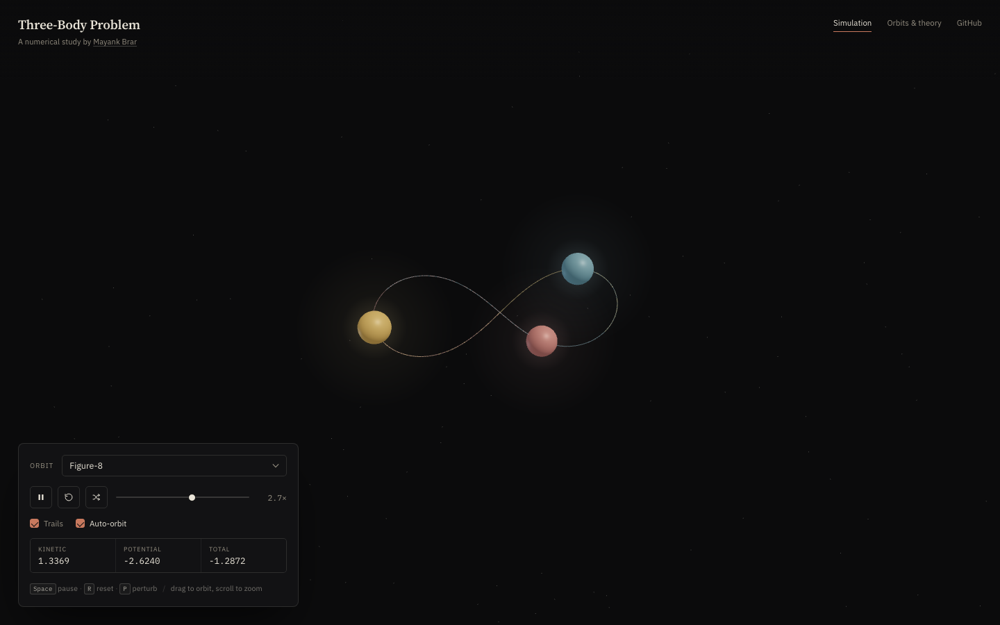

# Three-Body Problem Simulator

An interactive, fully 3-D simulator of the gravitational three-body problem — with **25 periodic-orbit and classical presets whose initial conditions are numerically verified** before they ship.



**Live demo:** https://bmo-can-code.github.io/three-body-orbital-simulator/

---

## What makes this different

Most three-body demos ship presets copy-pasted from a paper's summary table. Those 5-digit values are *not* accurate enough for the choreographies: integrated forward in time, the "periodic" orbits quietly fly apart. This project fixes that.

- **15-digit initial conditions** for every Šuvakov–Dmitrašinović family (via the van derbei continuing suite), not the 5-digit rounding.
- **Adaptive, symplectic Velocity Verlet** integrator: `h = min(hMax, c · r_min / v_rel)`, so close encounters automatically get smaller steps.
- **Per-preset integrator settings.** Every orbit ships with the timestep, `c` and softening that keep it bound and energy-conserving for `t = 400`.
- **`npm run verify`** re-runs the whole catalogue and fails the build if any preset escapes or drifts.

## Verified preset catalogue

`npm run verify` integrates every preset to `t = 400` with adaptive Velocity Verlet and checks energy drift, maximum radius, and momentum conservation.

| Group | Presets | Result |
| --- | --- | --- |
| Choreographies | Figure-8, Butterfly II–IV, Moth I–III, Dragonfly, Yarn, Bumblebee, Yin-Yang I / I-b / II / II-b, Newest | bounded, energy drift < 3% |
| Broucke–Hénon | Broucke–Hénon | bounded, drift < 0.001% |
| Classical | Lagrange Triangle, Trojan Triangle, Euler Collinear | exact (Lagrange/Euler linearly unstable by nature) |
| Famous | Burrau "Pythagorean" | chaotic, energy conserved ~1.4% |
| Non-periodic | Chaotic, Slingshot, Ejection, Binary Capture, Hierarchical triple | open systems; energy conserved |

> `ok(*)` in the verifier marks solutions that are exact but *linearly unstable* (Lagrange, Euler). Their eventual breakup is physical, not a bug — nudge them with **Perturb** to see chaos unfold.

## Features

- **3D rendering** (Three.js r160) with per-body glow sprites and fading colour-coded trails.
- **Live energy readout** of kinetic, potential and total energy next to the controls.
- **Play / pause / reset / perturb**, trails toggle, auto-orbit, and a 0.1×–30× speed slider.
- **Separate Orbits & Theory page** (`learn.html`): a clickable gallery of all 25 presets with descriptions, the eleven canonical outcomes of a three-body encounter, and the maths behind the simulation. Clicking an orbit loads it in the simulator.
- **Deep links:** `index.html?preset=figure8` loads any preset directly.
- **Keyboard shortcuts:** `Space` play/pause · `R` reset · `P` perturb.
- **Responsive** — collapses to a bottom sheet on mobile.

## Running locally

No build step; it's plain ES modules — but it **must be served over HTTP**.
Opening `index.html` directly (double-clicking it) will not work: browsers block
JavaScript modules on `file://`.

On macOS, double-click **`start.command`** — it starts a server and opens the page.

Or from a terminal:

```bash
npm run dev          # serves http://localhost:8000
```

Or with any static server:

```bash
python3 -m http.server 8000
```

Then open <http://localhost:8000>.

## Verifying the physics

```bash
npm run verify
```

This runs `verify-presets.mjs`: it loads every preset through the same `physics.js` used by the site, integrates adaptively to `t = 400`, and reports

```
preset           cfg           drift%      maxR     r/r0        |P|    verdict
figure8          default     0.002009      1.08     1.08    1.1e-14       PASS
...
ALL PRESETS VERIFIED
```

Exit code is non-zero if any preset escapes or drifts beyond tolerance — so the catalogue can't silently rot.

## Project layout

```
index.html            # simulator markup, import-map for Three.js
learn.html            # Orbits & Theory page (gallery, outcomes, methods)
style.css             # editorial UI, responsive layout, article typography
script.js             # Three.js scene, render loop, input, trails, energy HUD
learn.js              # builds the preset gallery on the theory page
physics.js            # integrator + conservation laws (shared by site & verifier)
presets.js            # the 25-preset catalogue + analytic builders
verify-presets.mjs    # CI-style verification gate (npm run verify)
start.command         # macOS double-click launcher for a local server
```

`physics.js` and `presets.js` are imported by **both** the browser app and Node, so what you see on screen is exactly what is verified.

## Physics notes

- **Gravitation:** `aᵢ = Σⱼ≠ᵢ G mⱼ (rⱼ − rᵢ) / (|rⱼ − rᵢ|² + ε²)^{3/2}` — note the pull uses the *other* body's mass. (The single most common bug in home-made N-body code is multiplying by the body's own mass; this project doesn't.)
- **Integrator:** kick–drift–kick Velocity Verlet, symplectic and time-reversible; the half-kick is applied *before* the drift so the scheme is genuinely second-order.
- **Softening** `ε` keeps the force finite during the closest passes; each preset ships the `ε` that verifies it.
- **Centre-of-mass frame:** every preset is shifted to zero net position and momentum at load.

## Credits & references

Initial conditions and orbit families:

- Moore (1993); Chenciner & Montgomery (2000) — the Figure-8 choreography.
- Šuvakov & Dmitrašinović (2013), *Three classes of Newtonian three-body planar periodic orbits*, Phys. Rev. Lett. — the 13 family catalogue. High-precision initial conditions via the [van derbei three-body gallery](https://vanderbei.princeton.edu/WebGL/Suki.html).
- Broucke (1975); Hénon (1976) — the isosceles periodic families.
- Lagrange (1772); Euler (1767) — the classical equilateral and collinear solutions.
- Burrau (1913); Szebehely & Peters (1967) — the Pythagorean problem.

## License

MIT © Mayank Brar
